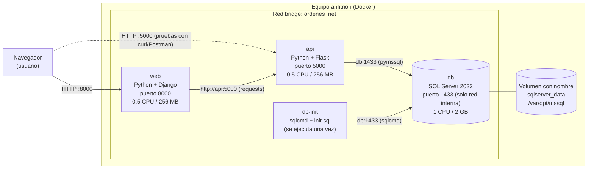
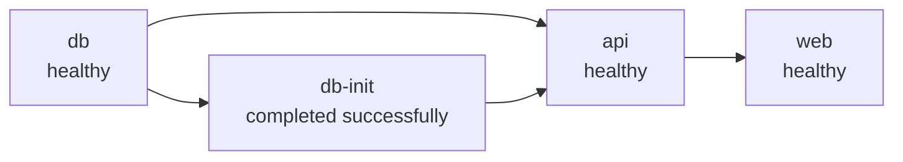

# Diagrama de la arquitectura

Tres contenedores (más un servicio de inicialización de un solo uso) conectados por una red bridge propia. Solo `api` se conecta a SQL Server; `web` consume la API por el nombre del servicio.

## Orden de arranque (`depends_on` con `service_healthy`)

