# Órdenes de venta en 3 contenedores

Examen práctico del segundo parcial — Arquitectura de Computadoras.
Aplicación de órdenes de venta con **SQL Server 2022** (`db`), **API REST en Flask** (`api`) y **frontend en Django** (`web`), levantada con Docker Compose.

## Integrantes

| Nombre completo | Número de cuenta |
|-----------------|------------------|
| _STANLEY LEMUEL GOFF STERBROOCK_ | _202410060287_ |
| _RUT NOHEMY SANCHEZ GARCIA_ | _202010060043_ |
| _NELSON JAVIER GUERRA NOLASCO_ | _202320020194_ |
| _JOSE ALFREDO MEJIA GRANADOS_ | _202510060768_ |
| _RAUL ANDRES RAUDALES GARCIA_ | _202510010696_ |

## Imágenes en Docker Hub

- API: `https://hub.docker.com/r/stanleygoff/ordenes-api` (etiqueta `v1.0`)
- Web: `https://hub.docker.com/r/stanleygoff/ordenes-web` (etiqueta `v1.0`)

## Arquitectura

Diagrama completo (contenedores, red, volumen y puertos) en **[DIAGRAMAS.md](DIAGRAMAS.md)**.

| Servicio | Tecnología | Puerto | Límites |
|----------|-----------|--------|---------|
| `db` | SQL Server 2022 (imagen oficial) | 1433 (solo red interna) | 1 CPU / 2 GB |
| `db-init` | Misma imagen, ejecuta `sqlcmd` con `db/init.sql` y termina | — | 0.25 CPU / 256 MB |
| `api` | Python 3.12 + Flask + pymssql | 5000 | 0.5 CPU / 256 MB |
| `web` | Python 3.12 + Django + requests | 8000 | 0.5 CPU / 256 MB |

Red: `ordenes_net` (bridge). Volumen: `sqlserver_data` montado en `/var/opt/mssql`.

## Estructura del repositorio

```
.
├── api
│   ├── app.py
│   ├── Dockerfile
│   └── requirements.txt
├── compose.yaml
├── db
│   └── init.sql
├── DIAGRAMAS.md
├── documentacion.tex
├── evidencias
├── README.md
└── web
    ├── config
    │   ├── __init__.py
    │   ├── settings.py
    │   ├── urls.py
    │   └── wsgi.py
    ├── Dockerfile
    ├── manage.py
    ├── ordenes
    │   ├── api.py
    │   ├── forms.py
    │   ├── __init__.py
    │   ├── urls.py
    │   └── views.py
    ├── requirements.txt
    └── templates
        ├── base.html
        ├── base_original.html
        └── ordenes
            ├── confirm_delete.html
            ├── form.html
            ├── orden_detail.html
            └── orden_list.html

9 directories, 26 files

```

## Ejecutar el proyecto desde cero

Requisitos: Docker Engine con el plugin Compose v2, y al menos 3 GB de RAM libres (SQL Server necesita 2 GB).

```bash
git clone https://github.com/Stanley-Goff/ARQ-EXA-PII-Ordenes.git

cd ordenes-docker

cp .env.example .env
# Edite .env: ponga una contraseña segura en MSSQL_SA_PASSWORD
# (Considere un mínimo de 8 caracteres con mayúsculas, minúsculas y números) y su usuario de Docker Hub.

#Descargar las imagenes de Docker Hub y levantar la arquitectura
docker compose pull
docker compose up -d --no-build

#Alternativamente si el comando anterior falla, ejecutar los siguientes comandos
docker compose up -d --build
docker compose ps -a
```

La primera vez SQL Server tardara un poco más en estar listo; Compose espera por sí solo (healthchecks). Cuando termine:

| Qué | URL |
|-----|-----|
| Frontend (CRUD) | http://localhost:8000 |
| API | http://localhost:5000/api/ordenes |
| Salud de la API | http://localhost:5000/health |

`docker compose ps -a` mostrará `db`, `api` y `web` como `healthy` y `db-init` como `Exited (0)`: es normal, es el servicio de inicialización que ya terminó.

> **Fedora (SELinux):** el montaje de `init.sql` usa la opción `:z` para que SELinux permita leerlo desde el contenedor; no hace falta desactivar SELinux.

### Cómo se ejecuta `init.sql`

Lo ejecuta automáticamente el servicio `db-init` con `sqlcmd` apenas `db` está sano, y la `api` solo arranca cuando `db-init` terminó con éxito. El script es idempotente (crea la base, las tablas y las 5 órdenes de prueba solo si no existen), así que puede repetirse sin duplicar datos. Para correrlo manualmente:

```bash
docker compose run --rm db-init
```

### Detener y limpiar

```bash
docker compose down        # detiene y elimina contenedores; los datos se conservan en el volumen
docker compose down -v     # además BORRA el volumen (reinicia la base desde cero)
```

## Endpoints de la API

| Método | Ruta | Acción | Códigos |
|--------|------|--------|---------|
| GET | `/api/ordenes` | Listar órdenes | 200 |
| GET | `/api/ordenes/<id>` | Ver una orden con sus detalles | 200, 404 |
| POST | `/api/ordenes` | Crear una orden | 201, 400 |
| PUT | `/api/ordenes/<id>` | Actualizar una orden | 200, 400, 404 |
| DELETE | `/api/ordenes/<id>` | Eliminar una orden y sus detalles | 200, 404 |
| GET / POST | `/api/ordenes/<id>/detalles` | Listar o agregar detalles | 200 / 201, 400, 404 |
| PUT / DELETE | `/api/detalles/<id>` | Actualizar o eliminar un detalle | 200, 400, 404 |
| GET | `/health` | Estado de la API y de la conexión a la base | 200, 503 |

El `total` de la orden se recalcula cada vez que se agrega, modifica o elimina un detalle.

### Pruebas con curl

```bash
# Listar y ver una orden
curl -s localhost:5000/api/ordenes
curl -s localhost:5000/api/ordenes/1

# Crear una orden con detalles
curl -s -X POST localhost:5000/api/ordenes -H "Content-Type: application/json" \
  -d '{"cliente":"Cliente Prueba","estado":"Pendiente","detalles":[{"producto":"Mouse","cantidad":2,"precio_unitario":350}]}'

# Actualizar la orden
curl -s -X PUT localhost:5000/api/ordenes/1 -H "Content-Type: application/json" -d '{"estado":"Anulada"}'

# Agregar, actualizar y eliminar un detalle (el total se recalcula)
curl -s -X POST localhost:5000/api/ordenes/1/detalles -H "Content-Type: application/json" \
  -d '{"producto":"Cable USB","cantidad":3,"precio_unitario":80}'
curl -s -X PUT localhost:5000/api/detalles/1 -H "Content-Type: application/json" -d '{"cantidad":5}'
curl -s -X DELETE localhost:5000/api/detalles/1

# Errores esperados
curl -s -i localhost:5000/api/ordenes/9999                                   # 404
curl -s -i -X POST localhost:5000/api/ordenes -H "Content-Type: application/json" -d '{}'   # 400

# Eliminar la orden con todos sus detalles
curl -s -X DELETE localhost:5000/api/ordenes/1
```


## Evidencias de ejecución

Las siguientes capturas documentan el funcionamiento de la arquitectura y las pruebas prácticas realizadas.

### 1. Estado de los servicios Docker

Verificación del estado de los contenedores mediante `docker compose ps -a`.

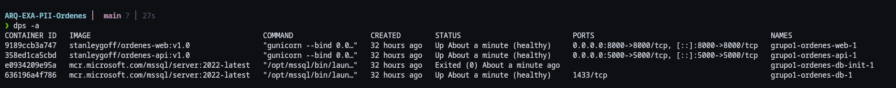

### 2. Operaciones CRUD desde Django

**Página principal y listado de órdenes**

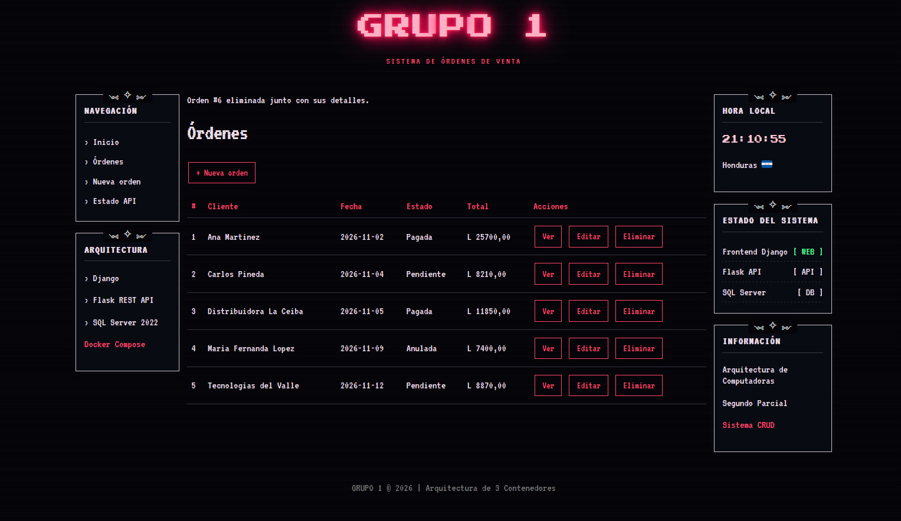

**Visualización de una orden**

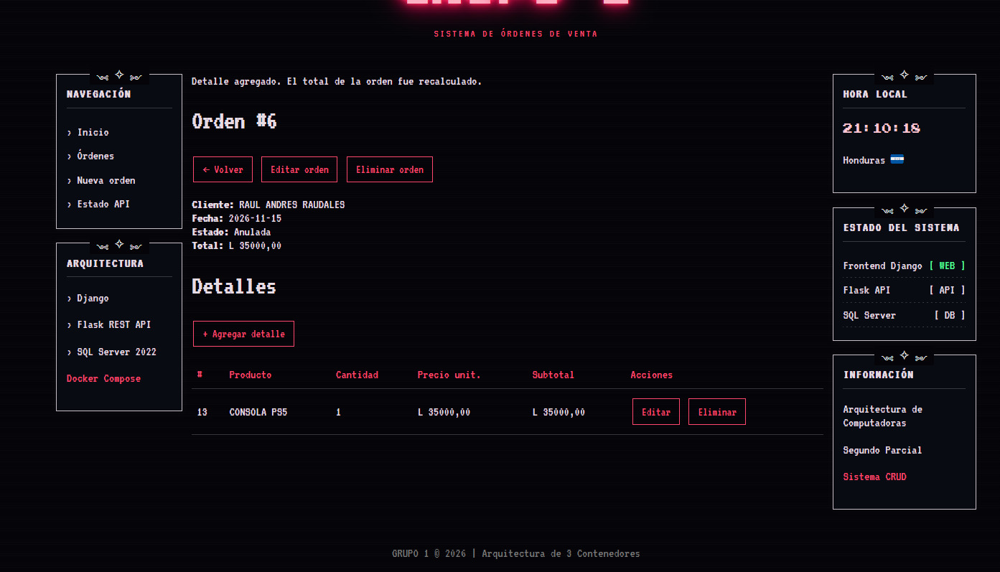

**Creación de órdenes**

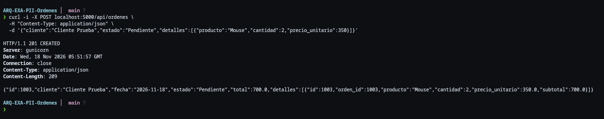

**Edición de órdenes**

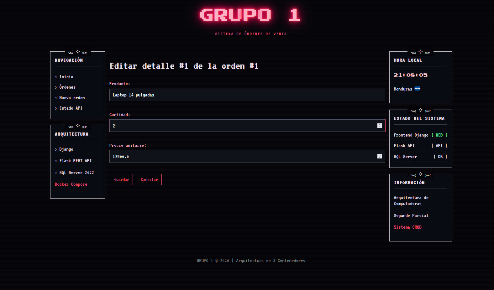

**Eliminación de órdenes**

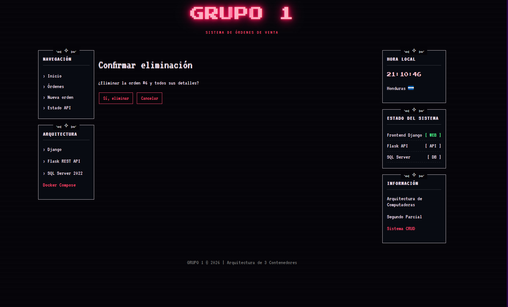

### 3. Pruebas de operaciones CRUD mediante la API REST

**Consulta de órdenes (GET)**

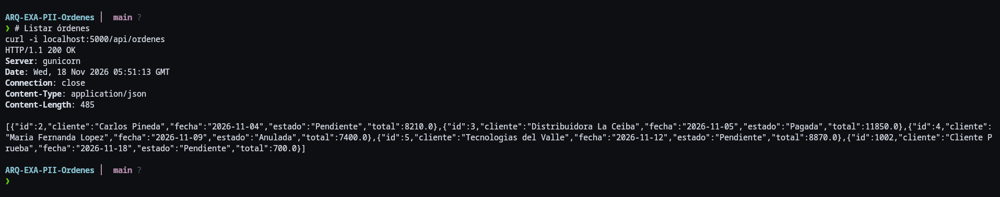

**Creación de órdenes (POST)**


**Actualización de órdenes (PUT)**

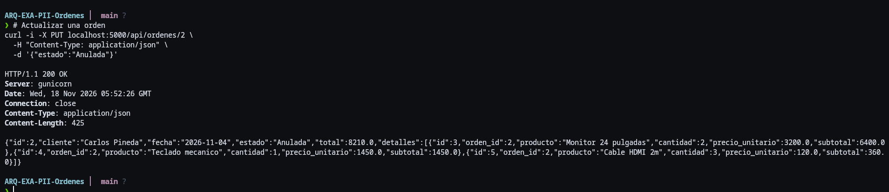

**Eliminación de órdenes (DELETE)**

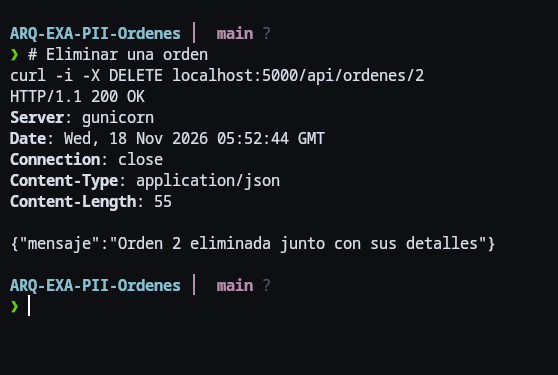

### 4. Persistencia de datos

Comprobación de la conservación de los registros después de detener y recrear los contenedores, utilizando el volumen persistente de SQL Server.

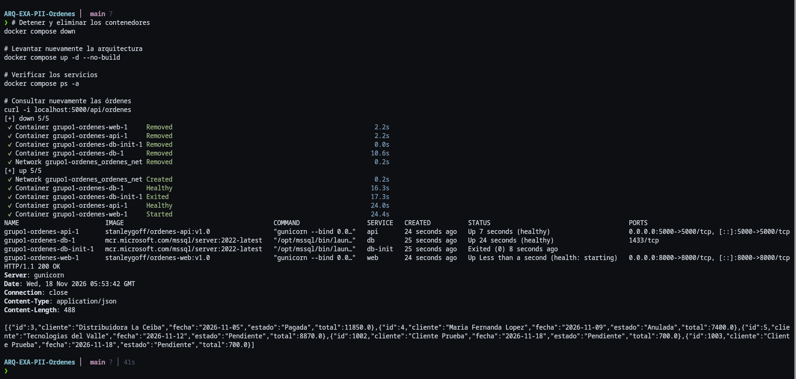

### 5. Límites y consumo de recursos

Supervisión del consumo de CPU y memoria de los contenedores mediante `docker stats`.

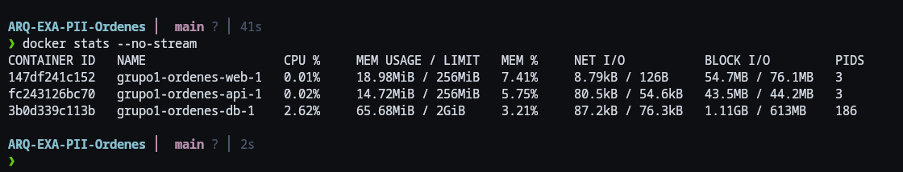